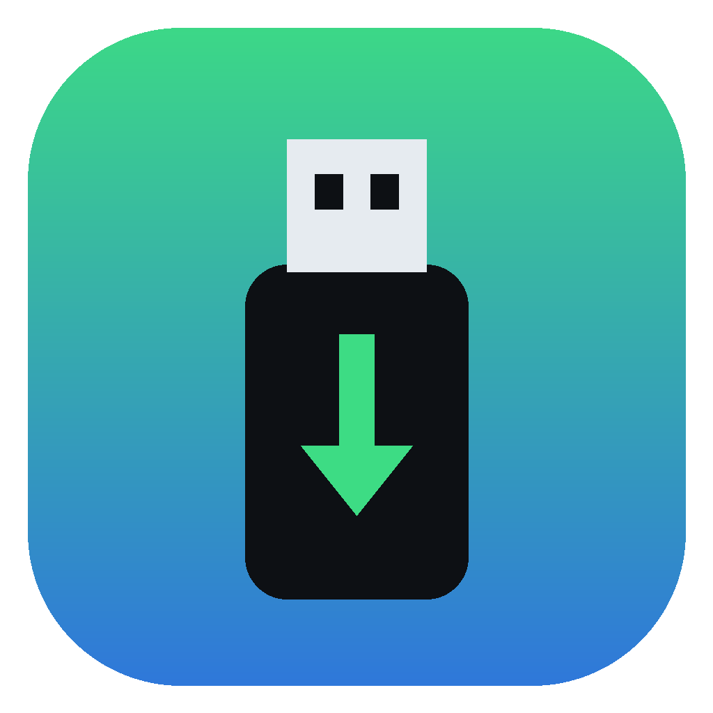

<p align="center">
  
</p>

<h1 align="center">Android USB Prep</h1>

<p align="center">
  Get a USB stick ready for your Android TV box in three simple steps.<br>
  Free · Windows &amp; Mac · No technical knowledge needed
</p>

---

## What it does

Android USB Prep sets up a USB stick so your Android TV box or streaming box can read it, and puts the apps you choose (APK files) in its **Download** folder, ready to install.

With one click it:

- Erases the USB stick and formats it the way Android boxes expect
- Creates the standard Android folders
- Copies your apps into the **Download** folder
- Checks every app copied over correctly
- Lets you eject the stick safely

> ⚠️ **Everything on the USB stick will be deleted.** Copy anything you want to keep onto your computer first.

---

## Download

Go to the **[Releases page](../../releases/latest)** and download the file for your computer:

| Your computer | File to download |
|---|---|
| **Windows 10 / 11** | The file ending in `x64-setup.exe` |
| **Mac** (Intel or Apple Silicon) | The file ending in `universal.dmg` |

---

## Install

### Windows

1. Double-click the `setup.exe` file you downloaded.
2. If a blue box says **"Windows protected your PC"**, click **More info**, then **Run anyway**.
3. Follow the installer, then open **Android USB Prep** from the Start menu.
4. When Windows asks **"Do you want to allow this app to make changes?"**, click **Yes**.
   The app needs this permission to format USB sticks.

### Mac

1. Double-click the `.dmg` file you downloaded.
2. Drag **Android USB Prep** into the **Applications** folder.
3. Open your **Applications** folder, **right-click** Android USB Prep and choose **Open**, then click **Open** again.

> **On macOS 15 (Sequoia) or newer:** if the app won't open, go to **System Settings → Privacy & Security**, scroll down, and click **Open Anyway**.
> You only need to do this the first time.

---

## How to use

**1. Plug in your USB stick**
It will appear in the app on its own. If it doesn't, click **Refresh**.
Click the stick to select it.

**2. Select your apps**
Choose the apps you want on the stick: drag your `.apk` files into the app, or click **Select APK files**.
These are copied into the stick's **Download** folder. You need at least one.

**3. Click "Prepare USB Drive"**
Check the name of the stick in the pop-up, then click **Erase & Prepare**.
Don't unplug the stick while this is running.

**4. Click "Safely Eject USB"**
When you see the green tick, click **Safely Eject USB**, then unplug the stick.

**On your Android box:** plug in the stick, open a file manager app, go to the **Download** folder and tap the app to install it.

---

## Advanced options

You don't need to change these. They are hidden under **Advanced options** in step 1.

| Option | What it does |
|---|---|
| **Standard Compatibility (FAT32)** | Default. Works on every Android box. Files must be smaller than 4 GB. |
| **Large Files over 4 GB (exFAT)** | Use only if you have a file bigger than 4 GB. Some older boxes can't read it. |
| **Cap FAT32 at 32 GB** | On by default. Makes 64 GB and 128 GB sticks work on older boxes. |
| **Also copy apps to the main folder** | For older boxes that only look for apps at the top level of the stick. |
| **Stick name** | The name shown on your box. Defaults to `ANDROID_USB`. |

---

## Troubleshooting

| Problem | Fix |
|---|---|
| My USB stick doesn't show up | Unplug it, plug it back in, then click **Refresh**. Try a different USB port. |
| "Write-protected" message | Some sticks have a small lock switch on the side. Slide it to unlock. |
| "Something is using the stick" | Close any windows or apps showing files from the stick, then try again. |
| My Android box can't see the stick | Try again with the default settings (FAT32 and the 32 GB cap both on). |
| An `.xapk` or `.apks` file won't install | These need an installer app on the box, such as **SAI (Split APKs Installer)**. |

---

## Safety

- Only USB sticks are shown. Your computer's own drives are **never** listed and can't be selected.
- Before erasing, the app checks again that it's still the same USB stick you picked.
- You always see a confirmation with the stick's name before anything is erased.

---

## For developers

Built with [Tauri v2](https://tauri.app) (Rust backend, plain HTML/CSS/JS frontend).

**Requirements:** Node.js LTS, Rust, plus Microsoft C++ Build Tools (Windows) or Xcode Command Line Tools (Mac).

```bash
npm install
npm run tauri dev      # run the app (Windows: use an Administrator terminal)
npm run tauri build    # build the installers
```

Installers are written to `src-tauri/target/release/bundle/`.

You can also build both platforms on GitHub: **Actions → Build apps → Run workflow**. The installers appear as a draft on the Releases page.

| Folder | Contents |
|---|---|
| `src/` | User interface |
| `src-tauri/src/lib.rs` | Main workflow and commands |
| `src-tauri/src/copy.rs` | File copying and verification |
| `src-tauri/src/platform/` | Windows (PowerShell) and Mac (`diskutil`) disk code |
| `src-tauri/capabilities/` | App permissions |
